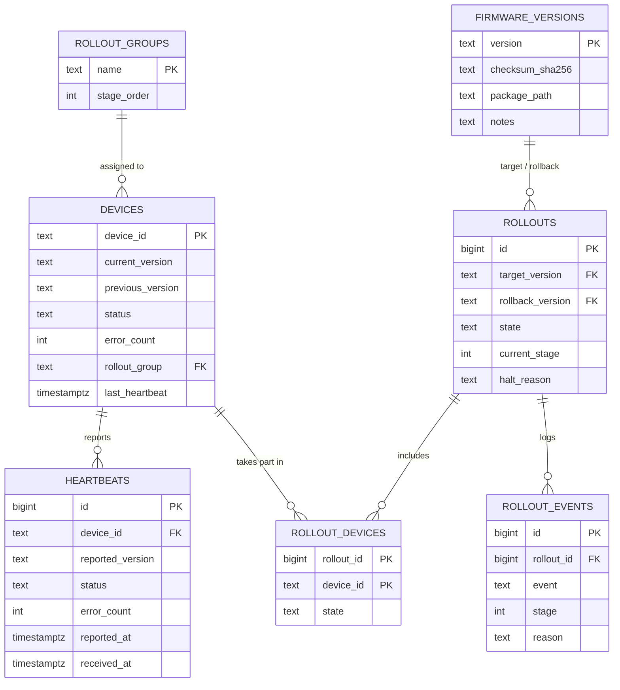

# Database Schema

Documentation for `deploy/registries/postgres/init.sql`, the PostgreSQL schema behind the OTA Fleet Manager registries.

- **Owners:** Nathan / David
- **Database:** PostgreSQL 16, running as a container in the control plane
- **Status:** Iteration 1 draft. Heartbeat fields still to be confirmed against the message formats (topics and messages task).

## 1. Purpose

The orchestrator needs to remember three things:

1. **What the fleet looks like right now.** Which devices exist, what version each runs, whether each is healthy.
2. **What the fleet has been doing.** A history of reports, so the dashboard can chart trends and the experiments can measure timing.
3. **What rollouts have happened.** Which version was released, how far it got, why it stopped, and what the orchestrator decided along the way.

The database is the **device registry** from the architecture. The **software registry** (the package files) lives in the file server, and the `firmware_versions` table here holds the metadata that points to those files.

## 2. Applying the schema

The Compose file mounts `init.sql` into the Postgres container:

```yaml
volumes:
  - ./postgres/init.sql:/docker-entrypoint-initdb.d/init.sql:ro
```

PostgreSQL runs files in that folder **only when the data volume is first created**. To apply changes after editing:

```bash
docker compose down -v     # deletes the database volume and all data
docker compose up -d
```

This is acceptable during development. Once real experiment data exists, back it up first.

## 3. Overview

| Table | Purpose | First needed |
|---|---|---|
| `devices` | Current state of each device (one row per device) | Iteration 1 |
| `heartbeats` | Every report received (history) | Iteration 1 |
| `firmware_versions` | Metadata for each package in the software registry | Iteration 1 |
| `rollout_groups` | The stages a device can belong to | Iteration 1 |
| `rollouts` | One row per release of a version to the fleet | Iteration 2-3 |
| `rollout_devices` | Each device's outcome within a rollout | Iteration 3 |
| `rollout_events` | Log of every orchestrator decision with its reason | Iteration 3 |
| `fleet_overview` (view) | `devices` plus seconds since last heartbeat | Iteration 1 |



## 4. Tables

### `devices`

The current state of the fleet. The orchestrator updates a device's row on every heartbeat, so the dashboard and rollout logic read one row per device rather than scanning history.

| Column | Meaning |
|---|---|
| `device_id` | Unique ID chosen by the fleet launcher, for example `device-001` |
| `current_version` | Last version the device reported |
| `previous_version` | The version the device keeps locally for rollback |
| `status` | One of the allowed status values (section 6) |
| `error_count` | Errors the device reported in its latest heartbeat |
| `rollout_group` | The stage in which this device receives updates |
| `last_heartbeat` | When the orchestrator last heard from the device |
| `registered_at`, `updated_at` | Bookkeeping timestamps |

### `heartbeats`

Append-only history. Every report becomes a row. It has two timestamps on purpose: `reported_at` is the device's own clock, and `received_at` is the orchestrator's clock when the message arrived. Experiments should measure timing from `received_at`, since all of those values come from one clock.

### `firmware_versions`

One row per package: version string, SHA-256 checksum (the agent verifies it before installing), the location of the package in the software registry, and a free-text note such as `healthy` or `faulty: crashes on start`. It is seeded with a placeholder `1.0`.

### `rollout_groups`

Four seeded stages: `canary` (1), `stage_10` (2), `stage_50` (3), `stage_100` (4).

### `rollouts`, `rollout_devices`, `rollout_events`

These are used once rollouts are automated.

- `rollouts` records the release: the version being rolled out, the `rollback_version` (last known good), the state, the current stage, and a `halt_reason` if it stopped.
- `rollout_devices` records, per device, whether it was commanded, updated, failed, or rolled back. Counting these gives **percent of fleet exposed** to a bad update.
- `rollout_events` logs each decision (started, stage advanced, halted, rollback started, rollback completed, completed) with a reason. This satisfies the requirement that every rollout decision is recorded, and it is the source for **time to detect** and **time to roll back**.

## 5. Design decisions

| Decision | Why | Alternative considered |
|---|---|---|
| **Separate `devices` and `heartbeats` tables** | `devices` answers "what is true now" with one row per device, so rollout checks stay fast. `heartbeats` keeps history for charts and experiments. | One table with only heartbeats. Every "current state" question would need a latest-row-per-device query. |
| **Text `CHECK` constraints instead of enum types** | Adding a status value is a one-line change. Postgres enums are awkward to modify. | `CREATE TYPE ... AS ENUM` |
| **`current_version` is not a foreign key** | If a device reports a version the registry doesn't know, the heartbeat should still be recorded. A rejected insert would hide the problem. | Foreign key to `firmware_versions`. Stricter, but a typo would drop data silently. |
| **Version strings as the primary key** | Versions are unique and readable (`2.1`), which makes queries and logs easier to understand. | A numeric surrogate key. Not worth the extra joins here. |
| **Rollout groups are stage numbers, not percentages** | Stage sizes are configuration in the orchestrator. The database only needs to know which stage a device is in. | Storing percentages. This would couple the schema to configuration. |
| **Rollout tables included from Iteration 1** | `init.sql` only runs on a fresh volume, so adding tables later means wiping data. They stay empty until used. | Add them in Iteration 3. Delete them from `init.sql` if you want a minimal Iteration 1. |
| **The orchestrator, not the database, decides "offline"** | The threshold is a tunable setting (for example 30 seconds). The `fleet_overview` view only exposes the age of the last heartbeat. | A computed offline flag in the schema. This would bake a threshold into SQL. |
| **`ON DELETE CASCADE` on child tables** | Removing a test device or rollout cleans up its history. | Restrict deletes. Safer in production, but annoying while developing. |
| **Timestamps as `timestamptz`** | Avoids time zone mistakes between the VM, laptop, and containers. | Plain `timestamp` |

## 6. Contract with the device agent and orchestrator

These values must match exactly between the agent, the orchestrator, and the database.

**Status values:** `unknown`, `healthy`, `degraded`, `unhealthy`, `updating`, `offline`

**Heartbeat message to column mapping** (to be confirmed against the topic and message formats):

| Message field | Database column |
|---|---|
| device ID | `devices.device_id`, `heartbeats.device_id` |
| version | `devices.current_version`, `heartbeats.reported_version` |
| status | `devices.status`, `heartbeats.status` |
| error count | `devices.error_count`, `heartbeats.error_count` |
| device timestamp | `heartbeats.reported_at` |
| (set on arrival) | `devices.last_heartbeat`, `heartbeats.received_at` |

If the agent sends more fields (CPU, uptime, error rate), add columns to `heartbeats` now, before the first data is collected.

**Recording a heartbeat** uses an upsert on `devices`, then an insert into `heartbeats`:

```sql
INSERT INTO devices (device_id, current_version, status, error_count, last_heartbeat)
VALUES (%(id)s, %(version)s, %(status)s, %(errors)s, now())
ON CONFLICT (device_id) DO UPDATE
  SET current_version = EXCLUDED.current_version,
      status          = EXCLUDED.status,
      error_count     = EXCLUDED.error_count,
      last_heartbeat  = EXCLUDED.last_heartbeat,
      updated_at      = now();

INSERT INTO heartbeats (device_id, reported_version, status, error_count, reported_at)
VALUES (%(id)s, %(version)s, %(status)s, %(errors)s, %(device_ts)s);
```

Run both statements in one transaction so the two tables never disagree.

## 7. Example queries

These are starting points for the Grafana dashboard and the experiments.

**Devices by version and status**

```sql
SELECT current_version, status, COUNT(*) AS devices
FROM devices
GROUP BY current_version, status
ORDER BY current_version, status;
```

**Devices that may be offline** (no heartbeat in 30 seconds)

```sql
SELECT device_id, seconds_since_heartbeat
FROM fleet_overview
WHERE seconds_since_heartbeat > 30;
```

**Error trend over time**

```sql
SELECT date_trunc('minute', received_at) AS time, SUM(error_count) AS errors
FROM heartbeats
GROUP BY 1
ORDER BY 1;
```

**Percent of the fleet exposed to each rollout**

```sql
SELECT r.id AS rollout_id,
       r.target_version,
       ROUND(100.0 * COUNT(*) FILTER (
             WHERE rd.state IN ('commanded', 'updated', 'failed', 'rolled_back'))
             / NULLIF((SELECT COUNT(*) FROM devices), 0), 1) AS percent_exposed
FROM rollouts r
JOIN rollout_devices rd ON rd.rollout_id = r.id
GROUP BY r.id, r.target_version;
```

**Seconds from rollout start to halt, and from halt to rollback complete**

```sql
SELECT rollout_id,
       EXTRACT(EPOCH FROM (
         MIN(created_at) FILTER (WHERE event = 'halted')
         - MIN(created_at) FILTER (WHERE event = 'started'))) AS seconds_to_halt,
       EXTRACT(EPOCH FROM (
         MIN(created_at) FILTER (WHERE event = 'rollback_completed')
         - MIN(created_at) FILTER (WHERE event = 'halted'))) AS seconds_to_rollback
FROM rollout_events
GROUP BY rollout_id;
```

Start-to-halt is a coarse proxy for detection time. For a precise figure, add an event when the faulty version is first applied.

## 8. Known limitations

- **No automatic cleanup of `heartbeats`.** At 50 devices reporting every few seconds the table grows quickly. For this project's duration that is fine. If it becomes a problem, delete old rows or aggregate them.
- **Single database, no replication.** If the container's volume is lost, so is the data. Back up before important experiment runs.
- **No authentication model for devices yet.** Any device ID is accepted. Per-device credentials belong with TLS and broker authentication.
- **Rollout state is only as accurate as the orchestrator.** The database records what the orchestrator tells it, so a crash mid-rollout can leave a rollout stuck in `in_progress`. The orchestrator should reconcile state on startup.

## 9. Change log

| Date | Change |
|---|---|
| Iteration 1 | Initial schema |