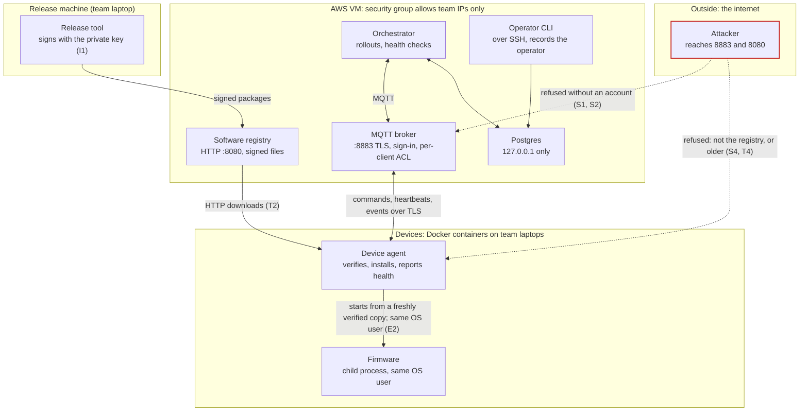

# OTA Fleet Manager — STRIDE Threat Model

As of 2026-11-22. Tests: `tests/security/` (`pytest -m security`).

Signed firmware holds up well: no test could get unsigned or altered firmware onto a device. Broker TLS and per-client sign-in (PR #49) closed the broker threats, and the device and network hardening on the `security/network-loss` branch closed the remaining open ones. No threat is open. Three are mitigated in part, and the one that matters is a policy choice for the team: a device that goes silent during its health window still halts the rollout (D12). Losing the network partway through an update never leaves a device half-installed. Brief outages are retried, and commands and results sent while a side is offline are delivered when it reconnects.

## Scope

This models `main` at commit `67e4f94` (PR #49, broker TLS and authentication; first written for `7132ff6`, Iteration 2) plus the fixes on the `security/network-loss` branch: the control plane on the AWS VM, the device agent and its firmware, and the release tool. The dashboard branch and the MQTT bridge prototype are out of scope.

**Assets**, most valuable first:

1. **Release private key** (`keys/release-private.pem`). Whoever holds it can ship firmware every device will run.
2. **Firmware running on devices**, and the device state it keeps (config and data files).
3. **Command channel**: update and rollback commands from the orchestrator.
4. **Fleet health data**: heartbeats and events. They decide whether a rollout halts and rolls back.
5. **Device registry** (Postgres): rollout history, versions and health.

**Attacker assumed:** someone who can reach the VM's ports 8883 (MQTT over TLS) and 8080 (registry), or sits on the network path to them. They can run their own web server and tamper with the registry's plain-HTTP traffic. They need a stolen account to publish MQTT messages, and don't have the release key or a shell on the VM.

**Assumptions:**

- The security group limits ports 22, 8883 and 8080 to team IP addresses (`deploy/cloud-vm-setup.md`), and Postgres listens only on the VM.
- The release key never leaves the release machine.
- The firmware is our own code, but a version can be buggy or compromised, so the agent shouldn't trust it.

## Data flows and trust boundaries

Three boundaries matter: the internet and the VM, the VM and the devices, and the agent and its firmware. Only firmware files are protected when they cross a boundary, by the release signature. MQTT crosses over TLS, with every client signed in and limited to its own topics; the agent and firmware run as the same OS user, but the firmware doesn't receive the agent's secrets and its edits to installed firmware are discarded before every start. Dashed lines are attacks the system refuses.

## Threats by STRIDE category

Thirty-one threats: 26 are mitigated, 3 are mitigated in part, none are open, and 2 are accepted. This table lists 25; the six about losing the network (D7 to D12) have their own section below it. The Iteration 3 broker TLS and authentication work closed S1, S2, R3, I3, I4 and D5 and limited D2. The device and network hardening closed S4, T3, T4, R2, E1, D7, D9 and D11 and limited D12. Risk is likelihood times impact for this deployment (a course project on a VM limited to team IPs). It would be higher on an open network.

| ID | Threat | Where | Mitigation today | Status | Risk | Test |
| --- | --- | --- | --- | --- | --- | --- |
| S1 | A client connects without an account and acts as the orchestrator or any device | Broker | `allow_anonymous false`; a password per client (each device's derived from a fleet secret and its ID) | Mitigated | Low | `test_S1_broker_rejects_anonymous_clients` |
| S2 | A client publishes commands, heartbeats or events for another device | Broker | ACL: a device writes only its own heartbeat and events and reads only its own commands; only the orchestrator writes commands | Mitigated | Low | `test_S2_broker_limits_each_client_to_its_own_topics` |
| S3 | A device reports heartbeats or events for another device through its own topic | Orchestrator | Payload `device_id` must match the topic | Mitigated | Low | `test_S3_*` (3 tests) |
| S4 | A forged command points a device at the attacker's server, and the device downloads from it | Device agent | Commands whose URLs aren't on the device's registry (`REGISTRY_URL`, default port 8080 on the broker host) are refused before any download | Mitigated | Low | `test_S4_device_only_contacts_the_registry` |
| T1 | Malformed command fields: `file://` URLs, a version that is a path, a bad checksum | Device agent | `parse_command` accepts only http(s) URLs, strict version and SHA-256 formats | Mitigated | Low | `test_T1_*` (3 tests, 27 cases) |
| T2 | Firmware altered in transit or on the registry (plain HTTP) | Registry, device | ed25519-signed manifest, SHA-256 and size, version check, safe unpacking, re-check before reuse | Mitigated | Low | `test_T2_*` (10 tests, 18 cases) |
| T3 | Firmware edits the unpacked `app/` folder of a kept version, which then runs on rollback | Device agent | Every start (boot, update, rollback, backing out) verifies the signed tarball and unpacks it again | Mitigated | Low | `test_T3_*` (2 tests) |
| T4 | A forged or replayed `update` installs an older signed version (downgrade) | Device agent | An `update` to an older version is refused; only `rollback` goes back | Mitigated | Low | `test_T4_*` (2 tests) |
| T5 | Database rows changed directly | Postgres | Listens only on the VM; password in `.env` | Mitigated | Low | `test_I2_database_is_reachable_only_from_the_host` |
| R1 | No record of what a rollout did or why | Device registry | `rollout_events` logs every change with time and reason | Mitigated | Low | `test_R1_every_rollout_change_is_logged_with_a_time` |
| R2 | No record of which operator started or rolled back a rollout | CLI | `rollout_events.actor`: the operator (`--operator` or `OTA_OPERATOR`), or `orchestrator` for automatic decisions | Mitigated | Low | `test_R2_operator_actions_record_who_did_them`, `test_operator_is_recorded_for_start_and_rollback` |
| R3 | A device's reports can't be tied to the device itself, since anyone can send them | Broker | Only the signed-in device can write its topics (S1, S2) | Mitigated | Low | via S1, S2 |
| I1 | Release private key leaks, and the attacker signs firmware | Release machine, git | Gitignored; no key in the repository | Mitigated | Medium | `test_I1_*` (2 tests) |
| I2 | Database reachable from the network | Postgres | Published on 127.0.0.1 only | Mitigated | Low | `test_I2_database_is_reachable_only_from_the_host` |
| I3 | MQTT traffic readable on the network: commands, versions, health | Broker | TLS only on 8883 (1883 closed); clients verify the broker against the project CA | Mitigated | Low | `test_I3_broker_listens_with_tls_only` |
| I4 | Firmware inherits the agent's whole environment, including its broker credentials | Device agent | Firmware gets the environment without `MQTT_*` and `DEVICE_SECRET` | Mitigated | Low | `test_I4_firmware_does_not_inherit_agent_secrets` |
| I5 | Firmware downloadable by anyone who reaches port 8080 | Registry | Security group; firmware is not secret | Accepted | Low | none |
| D1 | Huge or forged downloads exhaust a device | Device agent | 10 MB cap; manifest checked before the package is fetched | Mitigated | Low | `test_D1_*` (2 tests) |
| D2 | One client floods the broker with large or many messages | Broker | 64 KB `max_packet_size`; only signed-in clients; no rate limit yet | Mitigated in part | Low | `test_D2_broker_limits_message_size` |
| D3 | Out-of-range numbers break the database insert | Orchestrator | Validated against column ranges | Mitigated | Low | `test_D3_*` (3 cases) |
| D4 | Replayed commands or broken firmware take a device down | Device agent | Same-version commands do nothing; firmware that fails to start is backed out | Mitigated | Low | `test_D4_*` (2 tests) |
| D5 | One forged heartbeat reporting a crash halts a rollout and rolls the fleet back | Orchestrator health checks | Only the device itself can publish its heartbeat (S1, S2) | Mitigated | Low | via S1, S2 |
| D6 | Forged heartbeats from many invented device IDs fill the VM's disk (devices auto-register, no retention) | Postgres | None | Accepted | Low | none |
| E1 | Orchestrator and registry containers run as root | Containers | All three images run as unprivileged users (the stats collector, which reads the Docker socket, is out of scope) | Mitigated | Low | `test_E1_*` (2 tests, 3 cases) |
| E2 | Firmware runs as the agent's user, so it can write to the agent's firmware store | Device agent | Agent code and release key are root-owned; firmware gets no broker credentials (I4); its edits to installed firmware are discarded before every start (T3) | Mitigated in part | Low | `test_T2_device_code_and_release_key_are_read_only_for_the_agent`, T3 |

## Network loss at critical stages

Losing the network never leaves a device half-updated. A device installs only after a complete, verified download, and the install itself is atomic. Coordination now holds up too. Devices and the orchestrator keep persistent MQTT sessions, so the broker queues commands and results for a side that is offline, on disk. Devices retry brief download failures. What remains is policy: with the default limits, one device that stays silent through its health window, or whose download keeps failing, halts the rollout and rolls back every device updated so far (the whole fleet, unless the rollout runs in stages).

| ID | Stage | Link lost when | What happens today | Status | Risk | Test |
| --- | --- | --- | --- | --- | --- | --- |
| D7 | Command delivery | The device is offline as a command is sent | The broker queues the command (persistent session, kept on disk for 7 days) and delivers it on reconnect, a rollback included. The rollout still records the device as "not reached", which doesn't halt it. | Mitigated | Low | `test_D7_*` (3 tests) |
| D8 | Download | The transfer drops, is cut short or stalls through every retry | Fails safe: `update_failed` reported as a download failure, and the old firmware keeps running. Nothing is half-installed, a stall ends at the download timeout, and a 404 or a failed check is not retried. | Mitigated | Low | `test_D8_*` (5 tests, 8 cases) |
| D9 | Download | A brief outage hits one device | Each file is tried up to 3 times (1 s, then 2 s apart), so the update succeeds. Only an outage that outlasts the retries fails the update and, under the default limit of 0 failed devices, halts the rollout (plan item 13). | Mitigated | Low | `test_D9_*` (2 tests, 4 cases) |
| D10 | Install | Power or the link is lost mid-install | Only a staging folder is left behind. The device boots the previous version, and the next install replaces the leftover. | Mitigated | Low | `test_D10_install_cut_short_leaves_previous_version_bootable` |
| D11 | Result report | The orchestrator is disconnected when a device reports | The broker queues the result and delivers it on reconnect. A result that arrives after the command timeout still corrects the record. | Mitigated | Low | `test_D11_*` (3 tests) |
| D12 | Health window | An updated device loses its link | After 45 s of silence it's "unresponsive", the same verdict a bricked device gets, and the rollout halts and rolls back. The silent device now gets its rollback when it reconnects (D7). | Mitigated in part | Medium | `test_D12_*` (1 test) |

A cut-short download used to be reported as "package size does not match manifest", the same wording a tampered package gets. The device now compares what arrived with the `Content-Length` and reports it as a download failure, so a dropped link no longer looks like an attack (FR-10). Staged rollouts limit the damage of a false halt (D12) to the current stage, but don't prevent it.

## Highest risks

All of these are fixed except the release key handling (item 4) and the halt policy (item 6). The fixed ones are kept as a record of what each change closed.

1. **Anonymous broker without topic rules (S1, S2, D5, R3). Fixed.** Before the fix, anyone who could reach port 1883 could:
    - command any device to update or roll back;
    - fake events so a rollout records a device as updated or failed;
    - send one heartbeat with `crash_count: 1` for a device in its health window. The orchestrator then judges that device unhealthy, halts the rollout and rolls the whole fleet back.

    Per-client credentials and an ACL, with each device writing only its own topics and only the orchestrator writing commands, now remove all of this. Step 3a of the demo shows the broker refusing each attempt.
2. **Rollback could run planted code (T3, E2). Fixed.** The device re-checked the signed tarball but ran the already-unpacked `app/` folder, and firmware runs as the agent's user. So a compromised 2.0 could edit 1.0's `app/main.py`, and that code ran when the fleet rolled back to escape 2.0. This undermined rollback, the project's main recovery mechanism. Now every start verifies the tarball and unpacks it again, and the test's planted marker never appears.
3. **Forged commands could steer devices (T4, S4). Fixed.** A forged command (through the anonymous broker before PR #49; now only with stolen orchestrator credentials) could make a device download our genuinely signed files from the attacker's server, and install any older signed version with an `update` command. Devices now refuse URLs outside their registry and updates to older versions.
4. **Release key handling (I1).** The key stays out of git, which a test checks, but it sits on disk unencrypted, protected only by file mode 600. Losing it defeats every firmware check at once. That's why its risk is Medium despite a low likelihood.
5. **Plain-text MQTT (I3). Fixed.** Anyone on the path could read commands and the fleet's versions and health, and, once clients sign in, their passwords. The broker now accepts only TLS on 8883.
6. **One silent device halts the rollout (D12, D9).** A device that loses its link in its health window looks the same as one bricked by the update, so the rollout halts and rolls back every device updated so far. That is safe, but costly for a network blip. Whether silence and failed downloads should count toward a limit instead is a team decision (plan item 13).

## Security tests

92 tests in `tests/security/` check these threats, and all of them pass. CI already runs them with the unit and component tests; `pytest -m security` runs them alone in about 20 seconds. A database test (`test_operator_is_recorded_for_start_and_rollback`) also covers R2.

A test for a threat that is still open is marked `open_gap("ID", reason)`, which is pytest's `xfail(strict=True)`. CI passes while the threat is open, and the test fails as soon as someone fixes it. Removing the marker then turns it into a regression test. Every open-gap test has now been fixed this way, so none is left; a newly found threat starts with one.

| File | Level | What it attacks | Tests |
| --- | --- | --- | --- |
| `test_stride_static.py` | unit | Command and message parsers, the installer with hand-built signed packages (path traversal, links, bad entry points), `mosquitto.conf`, Dockerfiles, Compose ports, `.gitignore`, the schema, and every tracked file for private keys | 62 |
| `test_stride_device.py` | component | A real device agent running real firmware, against the genuine registry and an attacker's web server | 11 |
| `test_network_loss.py` | component and unit | A real device whose registry drops, cuts short or stalls the download, or loses power mid-install; the MQTT sessions; the orchestrator's rules for silent and failed devices | 19 |

The device tests attack for real, so they show each fix works, not just that a setting is present:

- **T3:** code planted in the kept 1.0 folder, or in the running version's own folder, never runs: not on rollback, not after a restart.
- **T4:** a forged `update` to 1.0 on a device running 2.0 is refused, while a real rollback to 1.0 still works.
- **S4:** given a command that points at the attacker's server, the device sends it no request at all.

## Mitigation plan

Thirteen changes, in order. Changes 1 to 6 and 8 to 11 are done, and change 7 in part: 1, 5 and 6 in the Iteration 3 TLS and authentication ticket (PR #49), the rest on the `security/network-loss` branch. Changes 12 and 13 are what's left. They finish D12 and fit the Health Evaluation and Rollback ticket; 13 needs a team decision first.

| Order | Change | Closes | Where | Ticket |
| --- | --- | --- | --- | --- |
| 1 (done) | Per-client passwords or certificates; `allow_anonymous false`; ACL: devices write only their own heartbeat and events topics and read only their commands; only the orchestrator writes commands | S1, S2, R3, D5; limits S4, T4 | `mosquitto.conf`, agent and orchestrator config | Iteration 3: MQTT TLS and authentication |
| 2 (done) | Before starting any version, verify its tarball and unpack it again (`Store.refresh_app`). Running firmware as its own user would also close E2 | T3; limits E2 | `installer.py`, `agent.py` | device hardening |
| 3 (done) | Refuse an `update` to a version older than the current one; older versions only through `rollback` (to any version, since `--rollback-to` lets the operator choose) | T4 | `agent.py` | device hardening |
| 4 (done) | Reject command URLs outside the registry the device is configured with (`REGISTRY_URL`) | S4 | `agent.py`, `config.py` | device hardening |
| 5 (done) | TLS listener on 8883, plain 1883 closed | I3 | `mosquitto.conf`, compose, security group | Iteration 3: MQTT TLS and authentication |
| 6 (done) | Pass firmware only the variables it needs (`FIRMWARE_STATE_DIR`, `PATH`, its tick settings) | I4 | `firmware_runner.py` | new: device hardening |
| 7 (`max_packet_size` done) | `max_packet_size` and connection limits on the broker | D2 | `mosquitto.conf` | Iteration 3: MQTT connection robustness |
| 8 (done) | `USER` in the orchestrator and registry Dockerfiles | E1 | Dockerfiles | any |
| 9 (done) | Record the operator (`--operator`, or `OTA_OPERATOR`) in `rollout_events.actor` | R2 | `cli.py`, `rollouts.py`, migration 005 | any |
| 10 (done) | Persistent MQTT sessions: devices and the orchestrator turn clean sessions off, and the broker keeps sessions on disk (`persistence true`, a `mosquitto-data` volume), so it holds QoS 1 commands and results while a side is offline | D7, D11 | `agent.py`, `main.py`, `mosquitto.conf`, compose | Iteration 3: MQTT connection robustness |
| 11 (done) | The device retries a failed download with backoff before reporting `update_failed`, and reports network failures separately from failed verification | D9 | `installer.py`, `agent.py` | Iteration 3: MQTT connection robustness |
| 12 | Reconcile from heartbeats: when a device comes back on the wrong version for its rollout, send its command again. Persistent sessions cover most of this; it still helps after the broker forgets a session (7 days) or loses its volume | D12 | `rollouts.py` | Iteration 3: Health Evaluation and Rollback |
| 13 | Team decision: let silence and failed downloads count toward a per-rollout limit, or wait for the device to report back, instead of halting on the first silent or failed device | D9, D12 | `rollout_logic.py`, orchestrator settings | Iteration 3: Health Evaluation and Rollback |

Two threats stay accepted: I5 (firmware isn't secret) and D6 (heartbeat retention matters only at a scale the project won't reach). Revisit D6 if the VM runs for weeks. Also worth considering: a passphrase on the release key (I1), and making CI's `security` tests a required check for merging to `main`.
