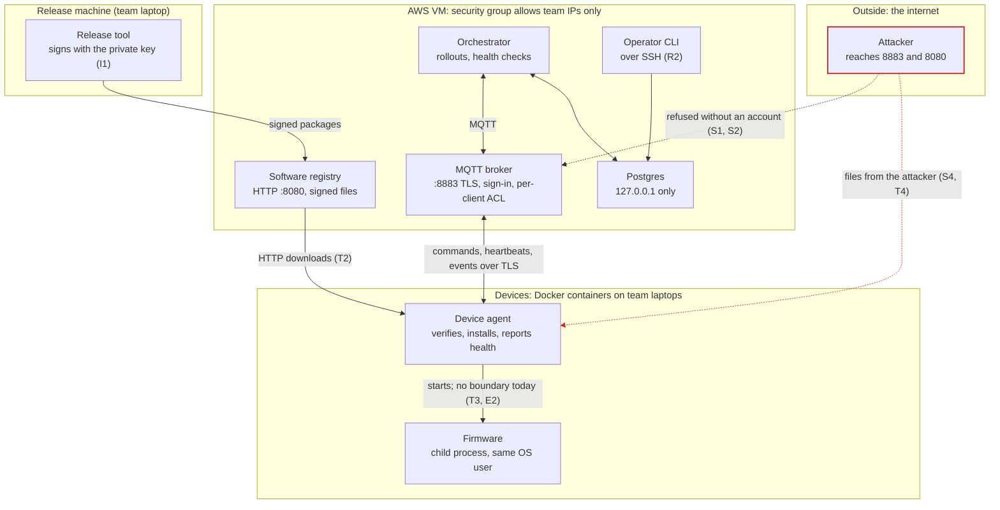

# OTA Fleet Manager — STRIDE Threat Model

As of 2026-11-16. Tests: `tests/security/` (`pytest -m security`).

Signed firmware holds up well: no test could get unsigned or altered firmware onto a device. The broker is the weak point. Anyone who can reach it can command any device, or fake the health reports that trigger an automatic fleet rollback. And three device-side gaps let a forged command do real damage even through the signature checks.

## Scope

This models `main` at commit `7132ff6` (Iteration 2, PR #44): the control plane on the AWS VM, the device agent and its firmware, and the release tool. The dashboard branch and the MQTT bridge prototype are out of scope.

**Assets**, most valuable first:

1. **Release private key** (`keys/release-private.pem`). Whoever holds it can ship firmware every device will run.
2. **Firmware running on devices**, and the device state it keeps (config and data files).
3. **Command channel**: update and rollback commands from the orchestrator.
4. **Fleet health data**: heartbeats and events. They decide whether a rollout halts and rolls back.
5. **Device registry** (Postgres): rollout history, versions and health.

**Attacker assumed:** someone who can reach the VM's ports 1883 (MQTT) and 8080 (registry), or sits on the network path to them. They can publish any MQTT message and run their own web server, but don't have the release key or a shell on the VM.

**Assumptions:**

- The security group limits ports 22, 1883 and 8080 to team IP addresses (`deploy/cloud-vm-setup.md`), and Postgres listens only on the VM.
- The release key never leaves the release machine.
- The firmware is our own code, but a version can be buggy or compromised, so the agent shouldn't trust it.

## Data flows and trust boundaries

Three boundaries matter: the internet and the VM, the VM and the devices, and the agent and its firmware. Only firmware files are protected when they cross a boundary, by the release signature. MQTT crosses over TLS, with every client signed in and limited to its own topics; the agent and firmware have no boundary between them beyond the firmware not receiving the agent's secrets. Dashed red lines mark where an open threat applies.

## Threats by STRIDE category

Twenty-five threats: 16 are mitigated, 2 are mitigated in part, 5 are open, and 2 are accepted. The Iteration 3 broker TLS and authentication work closed S1, S2, R3, I3, I4 and D5 and limited D2. Risk is likelihood times impact for this deployment (a course project on a VM limited to team IPs). It would be higher on an open network.

| ID | Threat | Where | Mitigation today | Status | Risk | Test |
| --- | --- | --- | --- | --- | --- | --- |
| S1 | A client connects without an account and acts as the orchestrator or any device | Broker | `allow_anonymous false`; a password per client (each device's derived from a fleet secret and its ID) | Mitigated | Low | `test_S1_broker_rejects_anonymous_clients` |
| S2 | A client publishes commands, heartbeats or events for another device | Broker | ACL: a device writes only its own heartbeat and events and reads only its own commands; only the orchestrator writes commands | Mitigated | Low | `test_S2_broker_limits_each_client_to_its_own_topics` |
| S3 | A device reports heartbeats or events for another device through its own topic | Orchestrator | Payload `device_id` must match the topic | Mitigated | Low | `test_S3_*` (3 tests) |
| S4 | A forged command points a device at the attacker's server, and the device downloads from it | Device agent | Signature check stops foreign firmware, but any host is contacted | Open | Medium | `test_S4_device_only_contacts_the_registry` |
| T1 | Malformed command fields: `file://` URLs, a version that is a path, a bad checksum | Device agent | `parse_command` accepts only http(s) URLs, strict version and SHA-256 formats | Mitigated | Low | `test_T1_*` (3 tests, 27 cases) |
| T2 | Firmware altered in transit or on the registry (plain HTTP) | Registry, device | ed25519-signed manifest, SHA-256 and size, version check, safe unpacking, re-check before reuse | Mitigated | Low | `test_T2_*` (10 tests, 18 cases) |
| T3 | The unpacked `app/` folder is not re-checked before it runs; firmware can edit the kept previous version, which then runs on rollback | Device agent | Only the tarball is re-verified | Open | High | `test_T3_edited_unpacked_firmware_never_runs` |
| T4 | A forged or replayed `update` installs an older signed version (downgrade) | Device agent | None | Open | Medium | `test_T4_update_command_cannot_downgrade` |
| T5 | Database rows changed directly | Postgres | Listens only on the VM; password in `.env` | Mitigated | Low | `test_I2_database_is_reachable_only_from_the_host` |
| R1 | No record of what a rollout did or why | Device registry | `rollout_events` logs every change with time and reason | Mitigated | Low | `test_R1_every_rollout_change_is_logged_with_a_time` |
| R2 | No record of which operator started or rolled back a rollout | CLI | None | Open | Low | `test_R2_operator_actions_record_who_did_them` |
| R3 | A device's reports can't be tied to the device itself, since anyone can send them | Broker | Only the signed-in device can write its topics (S1, S2) | Mitigated | Low | via S1, S2 |
| I1 | Release private key leaks, and the attacker signs firmware | Release machine, git | Gitignored; no key in the repository | Mitigated | Medium | `test_I1_*` (2 tests) |
| I2 | Database reachable from the network | Postgres | Published on 127.0.0.1 only | Mitigated | Low | `test_I2_database_is_reachable_only_from_the_host` |
| I3 | MQTT traffic readable on the network: commands, versions, health | Broker | TLS only on 8883 (1883 closed); clients verify the broker against the project CA | Mitigated | Low | `test_I3_broker_listens_with_tls_only` |
| I4 | Firmware inherits the agent's whole environment, including its broker credentials | Device agent | Firmware gets the environment without `MQTT_*` and `DEVICE_SECRET` | Mitigated | Low | `test_I4_firmware_does_not_inherit_agent_secrets` |
| I5 | Firmware downloadable by anyone who reaches port 8080 | Registry | Security group; firmware is not secret | Accepted | Low | none |
| D1 | Huge or forged downloads exhaust a device | Device agent | 10 MB cap; manifest checked before the package is fetched | Mitigated | Low | `test_D1_*` (2 tests) |
| D2 | One client floods the broker with large or many messages | Broker | 64 KB `max_packet_size`; only signed-in clients; no rate limit yet | Mitigated in part | Low | `test_D2_broker_limits_message_size` |
| D3 | Out-of-range numbers break the database insert | Orchestrator | Validated against column ranges | Mitigated | Low | `test_D3_*` (3 cases) |
| D4 | Replayed commands or broken firmware take a device down | Device agent | Same-version commands do nothing; firmware that fails to start is backed out | Mitigated | Low | `test_D4_*` (2 tests) |
| D5 | One forged heartbeat reporting a crash halts a rollout and rolls the fleet back | Orchestrator health checks | Only the device itself can publish its heartbeat (S1, S2) | Mitigated | Low | via S1, S2 |
| D6 | Forged heartbeats from many invented device IDs fill the VM's disk (devices auto-register, no retention) | Postgres | None | Accepted | Low | none |
| E1 | Orchestrator and registry containers run as root | Containers | Device agent already runs as `agent` | Open | Low | `test_E1_*` (2 tests, 3 cases) |
| E2 | Firmware runs as the agent's user, so it can rewrite the agent's firmware store and talk to the broker | Device agent | Agent code and release key are root-owned | Mitigated in part | Medium | `test_T2_device_code_and_release_key_are_read_only_for_the_agent`, T3 |

## Highest risks

The broker came first: the Iteration 3 TLS and authentication work closed or limited seven threats (S1, S2, R3, I3, I4, D2, D5). Items 1 and 5 are kept below as a record of what it fixed; items 2 to 4 are still open.

1. **Anonymous broker without topic rules (S1, S2, D5, R3). Fixed.** Before the fix, anyone who could reach port 1883 could:
    - command any device to update or roll back;
    - fake events so a rollout records a device as updated or failed;
    - send one heartbeat with `crash_count: 1` for a device in its health window. The orchestrator then judges that device unhealthy, halts the rollout and rolls the whole fleet back.

    Per-client credentials and an ACL, with each device writing only its own topics and only the orchestrator writing commands, now remove all of this. Step 3a of the demo shows the broker refusing each attempt.
2. **Rollback can run planted code (T3, E2).** Before reusing a kept version, the device re-checks the signed tarball but runs the already-unpacked `app/` folder. Firmware runs as the agent's user. So a compromised 2.0 can edit 1.0's `app/main.py`, and that code runs when the fleet rolls back to escape 2.0. The test plants a marker this way, and the marker file appears. This undermines rollback, the project's main recovery mechanism.
3. **Forged commands steer devices (T4, S4).** Through the open broker, an attacker can make a device download from their own server. Serving our genuinely signed files, they can install any older signed version, such as one with a known bug, with an `update` command. The signature check works as designed, but nothing checks where files come from or whether the version is older.
4. **Release key handling (I1).** The key stays out of git, which a test checks, but it sits on disk unencrypted, protected only by file mode 600. Losing it defeats every firmware check at once. That's why its risk is Medium despite a low likelihood.
5. **Plain-text MQTT (I3). Fixed.** Anyone on the path could read commands and the fleet's versions and health, and, once clients sign in, their passwords. The broker now accepts only TLS on 8883.

## Security tests

71 tests in `tests/security/` check these threats: 65 pass, and 6 fail on purpose because they describe open threats. CI already runs them with the unit and component tests; `pytest -m security` runs them alone in about 5 seconds.

Each open threat has a test marked `open_gap("ID", reason)`, which is pytest's `xfail(strict=True)`. CI passes while the threat is open, and the test fails as soon as someone fixes it. Removing the marker then turns it into a regression test, so this list keeps itself up to date.

| File | Level | What it attacks | Pass | Open threat |
| --- | --- | --- | --- | --- |
| `test_stride_static.py` | unit | Command and message parsers, the installer with hand-built signed packages (path traversal, links, bad entry points), `mosquitto.conf`, Dockerfiles, Compose ports, `.gitignore`, the schema, and every tracked file for private keys | 59 | 3: R2, E1 (orchestrator and registry) |
| `test_stride_device.py` | component | A real device agent running real firmware, against the genuine registry and an attacker's web server | 6 | 3: T3, T4, S4 |

The device tests show the three open device-side threats happen, not just that a defence is missing:

- **T3:** code planted in the kept 1.0 folder writes a marker file when the device rolls back.
- **T4:** a forged `update` to 1.0 on a device running 2.0 reports `update_succeeded`.
- **S4:** the device fetches the manifest, signature and package from the attacker's server.

## Mitigation plan

Nine changes, in order, close every open threat except the two accepted ones. Changes 1, 5 and 6 are done (Iteration 3 TLS and authentication ticket, FR-7, NF-3), and change 7 in part. The next three are small device-agent changes that could go in a new Iteration 3 ticket. When a change lands, its tests stop failing on purpose: remove their `open_gap` marker.

| Order | Change | Closes | Where | Ticket |
| --- | --- | --- | --- | --- |
| 1 (done) | Per-client passwords or certificates; `allow_anonymous false`; ACL: devices write only their own heartbeat and events topics and read only their commands; only the orchestrator writes commands | S1, S2, R3, D5; limits S4, T4 | `mosquitto.conf`, agent and orchestrator config | Iteration 3: MQTT TLS and authentication |
| 2 | Before starting a kept version, unpack it again from its verified tarball, or run firmware as its own user that can't write `versions/` | T3, E2 | `installer.py`, device `Dockerfile` | new: device hardening |
| 3 | Refuse an `update` to a version older than the current one; allow older versions only through `rollback`, and only to the kept previous version | T4 | `agent.py` | new: device hardening |
| 4 | Download only from the registry the device is configured with: build URLs from the version, or reject other origins | S4 | `commands.py`, `config.py` | new: device hardening |
| 5 (done) | TLS listener on 8883, plain 1883 closed | I3 | `mosquitto.conf`, compose, security group | Iteration 3: MQTT TLS and authentication |
| 6 (done) | Pass firmware only the variables it needs (`FIRMWARE_STATE_DIR`, `PATH`, its tick settings) | I4 | `firmware_runner.py` | new: device hardening |
| 7 (`max_packet_size` done) | `max_packet_size` and connection limits on the broker | D2 | `mosquitto.conf` | Iteration 3: MQTT connection robustness |
| 8 | `USER` in the orchestrator and registry Dockerfiles | E1 | Dockerfiles | any |
| 9 | Record the operator (`--operator`, or the login user) in `rollout_events` | R2 | `cli.py`, a migration | any |

Two threats stay accepted: I5 (firmware isn't secret) and D6 (heartbeat retention matters only at a scale the project won't reach). Revisit D6 if the VM runs for weeks. Also worth considering: a passphrase on the release key (I1), and making CI's `security` tests a required check for merging to `main`.
